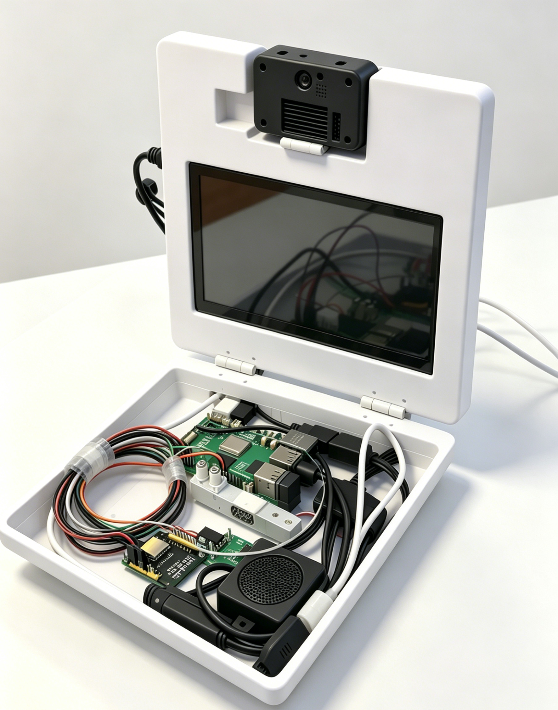

<p align="center">
  
</p>

# 知食分子 · Gourmet-AI

基于异构计算的多模态个性化膳食智能终端：语音对话 + 食材视觉识别 + Web UI。

## 实物展示

<p align="center">
  
</p>

## 功能概览

- **对话与库存**：DeepSeek 意图识别，增删改查冰箱食材（`smart_fridge.py`）
- **语音**：百度语音 ASR / TTS
- **视觉**：K230 拍照 + 百度食材识别，经 TCP 回传树莓派（`视觉k230_rpi_tcp/`）
- **界面**：Flask Web UI（`web.ui.py` + `UI/`）

## 快速开始

### 1. 配置私密信息（必做）

本仓库**不包含** API Key、WiFi 密码、内网 IP。请先本地创建配置：

```bash
cp local_config.example.py local_config.py
```

编辑 `local_config.py`，填入：


| 变量                                                 | 用途                |
| -------------------------------------------------- | ----------------- |
| `DEEPSEEK_API_KEY`                                 | DeepSeek 对话       |
| `BAIDU_SPEECH_API_KEY` / `BAIDU_SPEECH_SECRET_KEY` | 百度语音              |
| `BAIDU_VISION_API_KEY` / `BAIDU_VISION_SECRET_KEY` | 百度食材图像识别          |
| `WIFI_SSID` / `WIFI_PASSWORD`                      | K230 联网           |
| `K230_HOST` / `TCP_PORT`                           | 树莓派连接 K230        |
| `IMAGE_PATH`                                       | `api.py` 本地调试图片路径 |


`local_config.py` 已在 `.gitignore` 中，**请勿提交或上传**。

K230 板端：将 `local_config.py` 与对应脚本（如 `recognition.py`、`k230_tcp_server.py`）拷到同一目录。

### 2. 安装依赖

```bash
pip install -r requirements.txt
```

（若暂无 `requirements.txt`，至少需要：`requests`、`numpy`、`flask`、`flask-cors`。）

### 3. 运行

```bash
# Web UI（树莓派 / PC）
python web.ui.py

# 命令行助手
python smart_fridge.py

# K230 TCP 识别服务（在 K230 上）
# 见 视觉k230_rpi_tcp/k230_tcp_server.py

# 树莓派向 K230 发起识别
python raspberry_pi_client.py
# 或
python 视觉k230_rpi_tcp/raspberry_pi_client.py
```


## 目录结构

```
├── local_config.example.py   # 配置模板（可提交）
├── local_config.py           # 真实密钥（本地，勿提交）
├── _local_cfg.py             # 配置加载辅助
├── smart_fridge.py           # 主助手逻辑
├── web.ui.py                 # Flask Web UI
├── recognition.py            # K230 拍照识别
├── api.py                    # 百度图像识别示例
├── raspberry_pi_client.py    # 树莓派 TCP 客户端
├── db.py                     # SQLite 库存
├── UI/                       # 前端静态资源
└── 视觉k230_rpi_tcp/         # K230 ↔ 树莓派 TCP 方案
```


## 安全说明

- 不要把 `local_config.py`、`.env` 或含真实密钥的备份文件推送到 GitHub。


## License

仅供学习与项目演示使用。