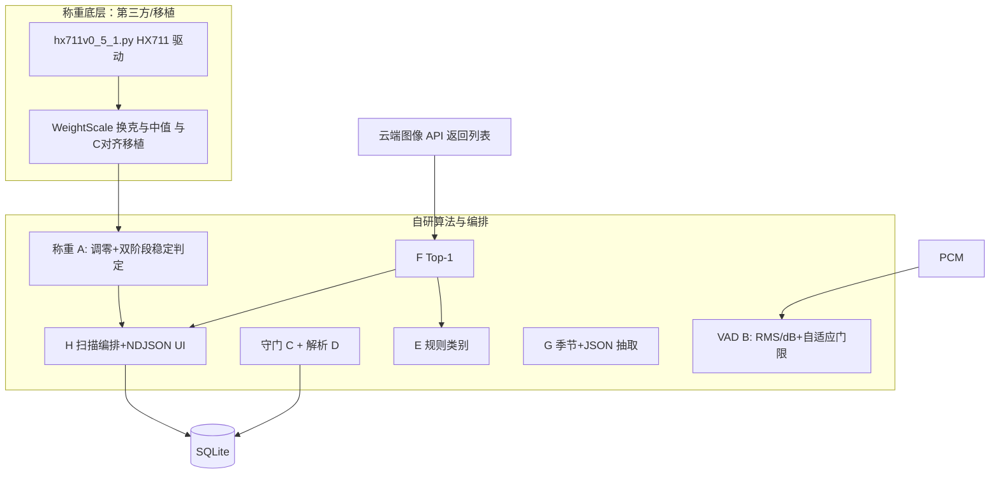

# 智能冰箱助手 — 自研算法说明材料

> 本文档**以本仓库自主设计与实现的算法为核心**，用于作品技术说明、答辩或申报材料。第三方大模型与云端识别接口仅在文末作**边界说明**，不展开为本文重点。**称重链路中，`hx711v0_5_1.py` 为第三方驱动；自研重点为 `weight_scale.py` 中的调零与稳定判定编排（见 §A）。**

---

## 0. 自研算法一览


| 编号  | 名称                                                                                        | 实现文件                                                                       | 类型                  |
| --- | ----------------------------------------------------------------------------------------- | -------------------------------------------------------------------------- | ------------------- |
| A   | **称重：自研「调零 + 双阶段稳定判定」**（底层读数为第三方 `hx711v0_5_1.py`；克数序列来自 `weight_scale.py` 中与 C 版对齐的移植换算） | `weight_scale.py`（判定/调零编排）；`hx711v0_5_1.py`（第三方驱动）                         | 状态机 + 门限判定          |
| B   | **自适应能量门限语音活动检测（VAD）与句尾检测**                                                               | `smart_fridge.py`（`SpeechRecognizer`）                                      | 短时特征 + 动态阈值 + 去抖状态机 |
| C   | **意图动作守门：置信度门控、破坏性/批量操作策略、参数合法性**                                                         | `smart_fridge.py`（`SmartFridgeAssistant._process_and_validate_action` 等）   | 决策与约束               |
| D   | **中文/阿拉伯数量解析与「数量+单位+名称」前缀切分**                                                             | `smart_fridge.py`（`chinese_to_number`、`extract_leading_quantity_and_unit`） | 轻量 NLP / 规则解析       |
| E   | **食材名称 → 业务类别（多层级关键词匹配）**                                                                 | `web.ui.py`（`infer_category_from_name`）                                    | 规则分类                |
| F   | **识别结果 Top-1 决策（按置信度最大选取）**                                                               | `recognition.py`（`parse_result`）                                           | 多候选融合               |
| G   | **季节映射 + 菜谱 JSON 稳健抽取**                                                                   | `web.ui.py`（`month_to_season`、`/api/recipes`）                              | 规则 + 正则解析           |
| H   | **自动入库流水线编排与流式进度事件**                                                                      | `web.ui.py`（`/ingredients/scan`）、`UI/app.js`（NDJSON 消费）                    | 多阶段编排               |


---

## A. 称重子系统：**自研「调零 + 稳定判定」** 与底层来源划分

### A.1 第三方驱动与「非本项自研」的换算层


| 组成                | 文件 / 符号                           | 说明                                                                                                        |
| ----------------- | --------------------------------- | --------------------------------------------------------------------------------------------------------- |
| **第三方源码**         | `hx711v0_5_1.py`（`HX711` 类）       | GPIO 位时序与 HX711 通讯、读取原始计数等，**为引用/既有开源实现，非本作品自研**。                                                         |
| **与嵌入式 C 版对齐的换算** | `weight_scale.py` 中 `WeightScale` | 在第三方驱动之上完成去皮、标定系数换克、5 点中值滤波与 `get_weight_g()` 等，**与既有 `main.c`/HX711 工程逻辑对齐，属移植与集成**，**不作为「新增自研算法」单独申报**。 |


自研叙述**不**将上述驱动与移植换算列为创新点；答辩时可直接说明：**在可靠读数接口之上，本作品新增的是调零流程与稳定判定状态机。**

### A.2 自研部分：要解决什么问题

在自动入库场景中，仅有一次性去皮往往不够：若程序启动时秤盘上**已有物体**，会把重物当皮重，载物后净重长期为 0；若未等读数稳定就锁重，会把晃动当最终克数。  
**自研目标**：在 `get_weight_g()` 已可用的前提下，用**可重复的调零顺序**与**门限 + 连续计数**判定「空秤可信」「载物已稳定」，并支持超时失败与流式进度，供 Web 与业务链调用。

### A.3 自研核心：`iter_read_stable_weight_progress`（及同类入口）

实现位置：`weight_scale.py`。以下逻辑为**本作品在驱动与移植换算之外新增编排**。

**输入依赖**：循环内调用 `WeightScale.get_weight_g()` 得到当前估计克数 `w`（该序列来自 A.1 中非自研声明层）。

**判定用常量**（与代码一致）：

- `STABLE_COUNT = 11`：连续 **11** 次满足同一档条件，才认定该阶段成立（文档口径「超过 10 次一致」）。
- `ZERO_BAND_G = 3`：`w ≤ 3` g 视为**近似零**（空秤带内）。
- `WEIGHT_MATCH_TOLERANCE_G = 1`：相邻读数差 ≤ **1** g 视为「同一档」非零重量，用于载物稳定计数。
- 采样间隔默认 `interval = 0.2 s`；空秤确认、载物过程各有**超时**；`PROGRESS_PING_SEC`（默认 1.5 s）控制向 UI 汇报 `empty_tick` / `weight_tick` 的最小间隔。

**自研调零与阶段 1 — 空秤确认（防错去皮）**

1. 首次 `get_tare()` 与 `reset_median_filter()`。
2. 在超时窗口内循环：若 `w ≤ ZERO_BAND_G`，**连续零档计数**累加；否则清零。
3. 连续零档计数 ≥ `STABLE_COUNT` → 认定**空秤稳定**，进入阶段 2；否则超时 → `phase: failed, reason: empty_timeout`。

**自研调零与阶段 2 — 锁零点后再称重**

1. `yield` 说明性 `phase`（如 `tare_lock`、`zero_locked`），再次 `get_tare()` 与 `reset_median_filter()`，**二次去皮锁定会话零点**。
2. 载物后：若 `w ≤ ZERO_BAND_G`，清空「非零稳定」累计；若 `w` 与上一档 `last_w` 在 `_same_stable_weight` 容差内视为同档，则 `consecutive_w++`，否则重置为 1 并更新 `last_w`。
3. `consecutive_w ≥ STABLE_COUNT` → `yield {"phase": "stable_weight", "weight_g": ...}` 并结束。
4. 载物阶段超时 → `phase: failed, reason: weight_timeout`。

**伪代码（仅描述自研编排）**：

```
调用移植层: get_tare, reset_median_filter
until 连续11次 w≤ZERO_BAND_G 视为空秤稳定 或 超时失败
调用移植层: 再次 get_tare, reset_median_filter   // 自研强调的「二次调零锁零点」
loop:
  w = get_weight_g()   // 来自第三方驱动 + WeightScale 移植
  if w≈0: 清空载物稳定计数
  else if w≈last_w: 载物稳定计数++
       if 载物稳定计数≥11: return 稳定克数
  else: 载物稳定计数=1, last_w=w
  可选: 按间隔 yield 进度 tick
```

`wait_stable_empty_scale`、`read_stable_weight_g` 为同一自研思想下的辅助封装（空秤等待或消费生成器直到稳定/失败）。

### A.4 与上层系统的接口（自研编排的输出形态）

- `read_stable_weight_g`：消费生成器直至 `stable_weight` 或 `failed`，返回标量克数或 `None`。
- `iter_read_stable_weight_progress`：**生成器**按阶段 `yield` 字典，驱动 `POST /ingredients/scan` 的 NDJSON 进度（与 §H 编排联动）。

以上接口的**价值**在于：把「何时算调零完成、何时算称重可提交」从单次读数里**剥离**为显式状态机，并与超时、失败原因、前端文案解耦。

---

## B. 自适应能量门限 VAD 与录音状态机（核心自研）

**文件**：`smart_fridge.py`，类 `SpeechRecognizer`（`calculate_db`、`calibrate_background_noise`、`record_audio_adaptive`）

### B.1 特征：短时 RMS → 分贝

对每段 PCM（16 bit 单声道），样本向量 `x`：

- `RMS = sqrt(mean(x²))`（实现中先转 `float32` 避免溢出）。
- `dB = 20·log10(RMS / 32767) + 100`，并截断到 `[0, 100]`，得到**无量纲响度特征**，用于与阈值比较。

### B.2 背景噪声标定（动态阈值基础）

录制 `CALIBRATION_DURATION` 内多段音频，每段 `CHUNK_DURATION`（默认 **0.08 s**）算一个 dB，收集后对 dB 列表取 `**np.median`** 作为背景估计 `background_db`，再计算：

- `silence_threshold = max(background_db + THRESHOLD_OFFSET, MIN_THRESHOLD)`  
- `voice_activation_threshold = silence_threshold + SPEECH_ACTIVATION_MARGIN_DB`（默认 **+7 dB** 才认为像「开口」）

从而在嘈杂厨房与安静环境间**自适应**抬升/降低门限。

### B.3 短时平滑与去抖

- 维护长度 `DB_SMOOTH_WIN = 8` 的 dB 队列，用 `**np.mean`** 作为当前帧平滑能量 `mean_db`，抑制 chunk 级抖动。
- **开始说话**：需连续 `VOICE_DEBOUNCE = 9` 帧满足 `mean_db ≥ voice_activation_threshold` 才置 `is_voice_active = true`（防误触）。
- **打断 TTS**：`mean_db` 高于 `playback_interrupt_threshold` 连续 `PLAYBACK_INTERRUPT_DEBOUNCE` 帧才停止播放，避免环境噪声误打断。

### B.4 句尾检测与「嘈杂中间带」

激活后：

- 若 `mean_db ≥ silence_threshold`，刷新「最后有声时刻」。
- 若处于 `silence_threshold - SILENCE_END_MARGIN_DB` 与 `silence_threshold` 之间（默认 **4 dB** 带宽），实现中**仍刷新**最后有声时刻，减轻油锅等持续中噪声导致的**假句尾**。
- 仅当低于 `deep_quiet` 且持续 `POST_SPEECH_WAIT_SEC`（默认 **1.2 s**）无刷新，才结束录音。

### B.5 其它状态保护

- **初始等待**：若 `INITIAL_WAIT_SEC`（默认 12 s）内从未激活 VAD，丢弃录音并返回失败，避免空转。
- **最大时长**：超过 `MAX_RECORD_DURATION`（默认 28 s）若仍未得到句尾静默，丢弃本次（常见持续高噪场景）。
- **最小幅长**：文件小于 `MIN_VALID_AUDIO_BYTES` 则视为无效。

以上整体为**有限状态机 + 多级迟滞与去抖**，不依赖端侧深度 ASR。

---

## C. 意图动作守门与执行策略（核心自研）

**文件**：`smart_fridge.py`，`SmartFridgeAssistant._process_and_validate_action` 及意图解析后的执行链。

### C.1 设计目标

云端返回的结构化意图可能存在越权、模糊或批量风险；本模块在**本地**做最终裁决。

### C.2 规则摘要


| 条件                                                                                    | 结果                              |
| ------------------------------------------------------------------------------------- | ------------------------------- |
| `action` 为空                                                                           | `DENIED`                        |
| `action ∈ DESTRUCTIVE_OPS`（如 `clear_inventory`）                                       | 一律 `PENDING`，禁止静默自动执行           |
| `remove_ingredient` 无 `id`/`name`                                                     | `DENIED`                        |
| `remove_ingredient`：`id` 不存在或 `name` 无法唯一归一化匹配                                        | `DENIED`                        |
| `add_ingredient` 无 `name`                                                             | `DENIED`                        |
| `update_ingredient` 无 `id` 且无 `name`                                                  | `DENIED`                        |
| `confidence ≥ AUTO_EXECUTE_CONFIDENCE_THRESHOLD`（默认 **0.75**）且已通过上述检查                 | `EXECUTED`，调用 `_execute_action` |
| `remove_ingredient` 且 `ids`/`names` 列表长度 ≥ `BULK_DELETE_CONFIRM_THRESHOLD`（默认 **10**） | `PENDING`，强制批量确认                |
| 其余通过校验但置信不足                                                                           | `PENDING`，引导用户确认                |


### C.3 意图解析后的参数规范化（与 AIService 协同）

对模型输出的 `<<ACTION:JSON>>` 经解析后，在本地完成（自研逻辑）：

- **动作名同义词映射**（如 `remove` → `remove_ingredient`）。
- **params 键白名单裁剪**：仅保留 `ALLOWED_OPERATIONS[action]` 允许的键。
- **数量字段**：字符串数量经 `chinese_to_number` 或 `float` 尝试规范化。
- **名称字段**：与 `extract_leading_quantity_and_unit` 联动，从「五个西红柿」类字符串中抽取数量、单位与纯名称（若模型未分列填写）。

另含 `**parse_action_string`**：在 JSON 解析失败时，对类自然语言 ACTION 串做**宽容键值提取**（正则），提高鲁棒性。

---

## D. 中文数量与「数量+单位+名称」切分（自研）

**文件**：`smart_fridge.py`

### D.1 `chinese_to_number(s)`

- 优先用正则提取**阿拉伯数字**子串并转 `float`。
- 否则在含中文数字字符时，按字符流累加：`零…九、两、十百千` 与 `十百千` 位权组合，得到**简单中文数词**对应的数值（适用于「五」「十五」「二十」等常见形式）。

### D.2 `extract_leading_quantity_and_unit(name)`

按**优先级**尝试多条正则模式：

1. 前导阿拉伯数字 + 允许单位词（`CHINESE_UNIT_TOKENS`）+ 余下名称；
2. 前导中文数词 + 单位 + 名称；
3. 紧凑形式「数词+单位+名称」无空格；
4. 阿拉伯数字与单位**紧贴**形式。

返回 `(quantity, unit, remaining_name)`，供入库参数补全。

---

## E. 业务类别推断（自研规则分类器）

**文件**：`web.ui.py`，`infer_category_from_name(name: str)`

- **优先级队列**：按固定顺序扫描关键词子串——先匹配奶制品类（如「奶」「芝士」等），再肉蛋类（「肉」「鸡」「鱼」「蛋」等），再果蔬类（「菜」「果」「椒」「菇」等字与典型果蔬词）。
- **未命中**则归为「其他」。
- 用于自动入库时**是否允许按「果蔬类」写入**等策略，与云端识别名称解耦，便于审计与解释。

---

## F. 多候选识别结果的 Top-1 决策（自研）

**文件**：`recognition.py`，`parse_result(result)`

- 校验百度返回无 `error_code` 且 `result` 非空。
- 在候选列表中取 `**score` 最大**的一条作为最终 `(name, score)`。

属于**确定性决策规则**，无学习参数。

---

## G. 季节规则与菜谱结构化响应抽取（自研）

**文件**：`web.ui.py`

### G.1 `month_to_season(month)`

北半球月份区间映射到「冬/春/夏/秋」四字季节标签，用于构造推荐 prompt 的**时令约束**（无学习）。

### G.2 `/api/recipes` 中的 JSON 抽取

- 将库存、偏好、季节拼为自然语言请求后，对模型返回的**任意文本**用正则 `\[\s*\{[\s\S]*\}\s*\]` 提取**最像 JSON 数组**的子串，再 `json.loads`；失败则返回空列表，避免前端崩溃。

---

## H. 自动入库流水线编排（自研）

**文件**：`web.ui.py`（`POST /ingredients/scan`）

**严格顺序**：称重稳定事件流 → 得到克数并下限校验 → 触发 K230/识别链 → `infer_category_from_name` → 果蔬类门禁 → 写库；每一步以 **NDJSON 行** 推送 `step` / `message` / `event`。

**文件**：`UI/app.js` — `readNdjsonLines`、`friendlyWeightProgressMessage`、`handleScanNdjsonObject`：将服务端 `weight_progress` 的 `phase` **映射为面向用户的短句**，属于**人机交互层算法**（状态到文案）。

---

## 数据流示意（突出自研模块）




---

## 创新点归纳（自研视角）

1. **称重（自研点）**：在第三方 HX711 驱动与移植换算提供的 `get_weight_g()` 之上，增加**双阶段调零**（先空秤连续判定、再二次去皮锁零点）与**载物连续一致稳定判定**，并配合超时与流式进度，针对**错误去皮**与**早锁重量**给出可复述流程；**不**将第三方驱动或中值换克本身申报为自研。
2. **VAD**：中位数背景估计 + 多级 dB 门限 + 滑动均值 + 双阈值去抖 + 嘈杂中间带刷新策略，在**无端侧 ASR 模型**前提下实现可用端点检测。
3. **安全执行**：置信度门控 + 破坏性操作强制确认 + 批量删除阈值 + 数据库存在性校验，形成 **LLM 输出不可直接写库** 的守门链。
4. **可解释入库**：物理稳定克数 + Top-1 识别名 + 规则类别三层合取，便于答辩中说明**决策依据**。

---

## 附录：外部模型与服务（非本文展开重点）

以下能力由**第三方**提供，本仓库以源码引用或 API 方式使用：

- `**hx711v0_5_1.py`**：HX711 Python 驱动（GPIO 读数等），**非本作品自研**。
- **DeepSeek** `deepseek-chat`：对话与意图草案生成（温度、system prompt 由本仓库配置，**网络权重不在仓内**）。
- **百度智能云**：食材图像分类接口、语音识别 ASR、语音合成 TTS。

**自研与外部的分界**：  

- **称重**：`hx711v0_5_1.py` 为**第三方驱动源码**；`WeightScale` 单次读克与中值滤波等为**与既有嵌入式工程对齐的移植**；**自研**为 `iter_read_stable_weight_progress` / `read_stable_weight_g` 等之上的**调零顺序与稳定/超时判定状态机**。  
- 其余：凡**语音门限状态机、规则分类、参数解析、执行门控、多阶段编排**等均为本地自研逻辑；**自然语言生成内容、声学模型、大规模图像分类网络**属外部云端服务。

---

## 代码索引（自研优先）


| 自研模块              | 主要文件与符号                                                                                               |
| ----------------- | ----------------------------------------------------------------------------------------------------- |
| 称重：**调零与稳定判定状态机** | `weight_scale.py`：`iter_read_stable_weight_progress`、`read_stable_weight_g`、`wait_stable_empty_scale` |
| 称重：第三方驱动          | `hx711v0_5_1.py`：`HX711`（非自研）                                                                         |
| 称重：移植换算与中值读克      | `weight_scale.py`：`WeightScale`（与 C 版对齐，非本项「新增自研」表述重点）                                                |
| VAD 与录音           | `smart_fridge.py`：`SpeechRecognizer`                                                                  |
| 守门与执行策略           | `smart_fridge.py`：`SmartFridgeAssistant._process_and_validate_action`                                 |
| 中文数量与名称切分         | `smart_fridge.py`：`chinese_to_number`、`extract_leading_quantity_and_unit`、`parse_action_string`       |
| 类别推断              | `web.ui.py`：`infer_category_from_name`                                                                |
| Top-1 识别          | `recognition.py`：`parse_result`                                                                       |
| 菜谱 JSON 抽取        | `web.ui.py`：`month_to_season`、`api_recipes`                                                           |
| 扫描流与前端映射          | `web.ui.py`：`post_ingredient_scan`；`UI/app.js`：`friendlyWeightProgressMessage` 等                      |


---

